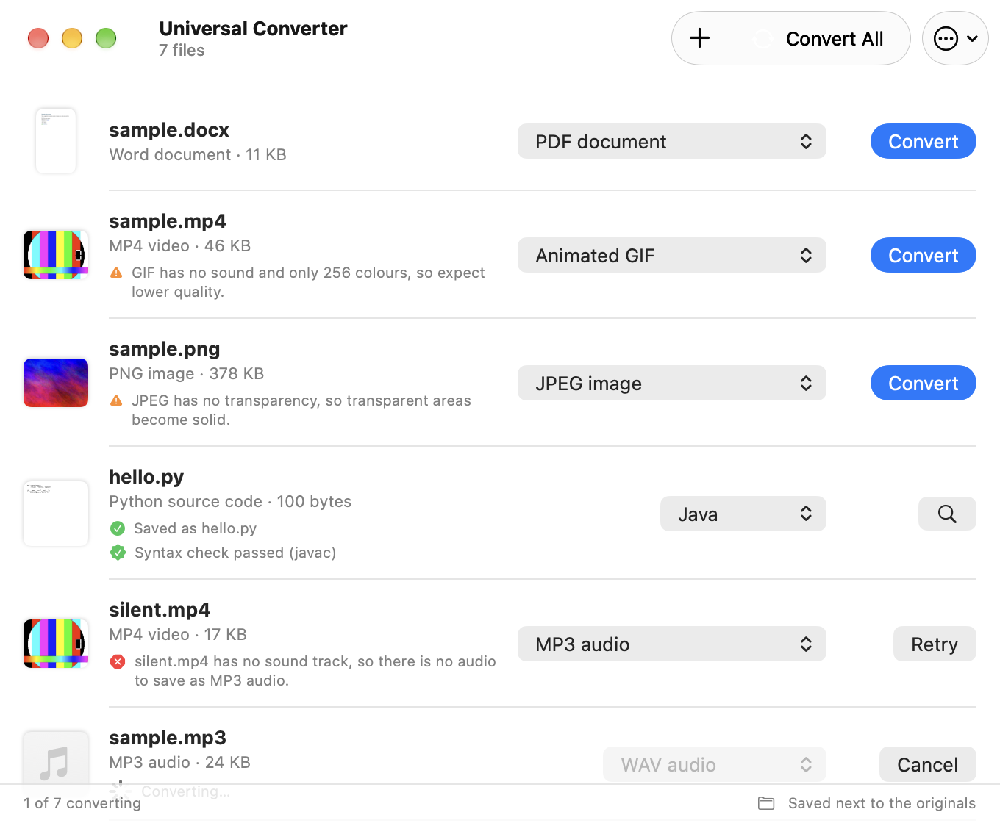
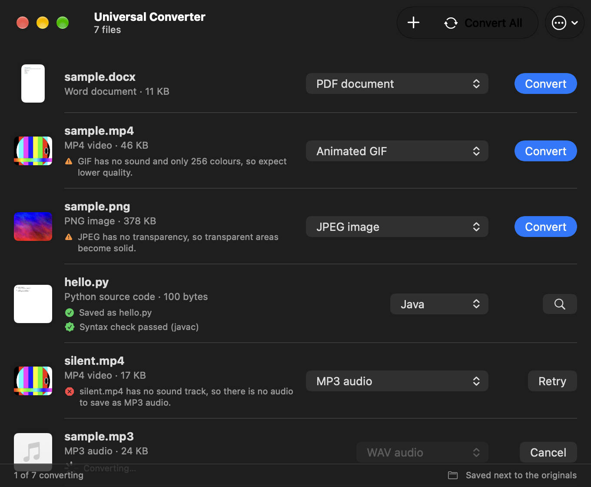

# Universal Converter

A native macOS app that converts files from one format to another. Drop a file on it, pick a format, and it does the rest. It reads what is *inside* a file to work out its type, so a file with the wrong name still works.

<p align="center">
  
  
</p>

Everything runs on your Mac. Nothing is uploaded. Code translation uses a model that runs locally through [Ollama](https://ollama.com).

## What it converts

| Kind | Formats |
|---|---|
| Video | MP4, MKV, WebM, AVI, MOV, WMV, FLV, 3GP, M2TS, MPG, VOB, GIF |
| Audio | MP3, WAV, FLAC, M4A, OGG |
| Images | PNG, JPEG, WebP, GIF, BMP, TIFF, AVIF, HEIC, camera RAW (CR2, CR3, NEF, ARW, DNG, RAF, ORF, RW2), SVG, PDF. Pictures can be compressed to a size you choose, resized, cropped, drawn as a sketch, or have their background removed. |
| Documents | DOCX, DOC, ODT, RTF, PDF, HTML, TXT, Markdown, EPUB, Jupyter notebooks. PDFs can be compressed to a size you choose. |
| Spreadsheets, slides | XLSX, XLS, ODS, CSV, PPTX, PPT, ODP |
| E-books | EPUB, MOBI, AZW3, FB2 |
| PostScript | PS, EPS |
| 3D models | OBJ, STL, PLY, COLLADA, glTF, GLB |
| Fonts | TTF, OTF, WOFF, WOFF2 |
| Subtitles | SRT, VTT, ASS |
| Archives | ZIP, 7z, tar.gz, tar, and RAR as input |
| Code | Python, Java, C, C++, Rust, JavaScript, TypeScript, Ruby, Go, C# |

Some conversions need several steps, such as Markdown to PDF. The app finds the chain for you and shows it in the format menu. See [GUIDE.md](GUIDE.md) for the full list.

## How it works

The app identifies the file, plans a route, and runs the right tools. Pictures use the frameworks built into macOS, and most other formats use a separate tool:

```
file  →  detect by content  →  plan a route  →  run each step  →  result
                                  (up to 3 steps)
```

| Tool | Used for |
|---|---|
| FFmpeg | Video, audio, subtitles |
| macOS (ImageIO, Core Image, Vision) | Pictures, HEIC, camera RAW, background removal, sketches |
| ImageMagick | WebP, AVIF, SVG, and pictures to PDF |
| LibreOffice | Documents, spreadsheets, slides |
| Pandoc | Markdown, HTML, EPUB, notebooks |
| Calibre | E-books |
| Poppler, Ghostscript | PDF and PostScript |
| Assimp | 3D models |
| 7-Zip, tar | Archives |
| fontTools | Fonts |
| Ollama | Code translation, checked afterwards with each language's own compiler or parser |

## Requirements

- A Mac with Apple silicon, running macOS 14 or later. (Built and tested on macOS 27.)
- [Homebrew](https://brew.sh), to install the tools.
- Xcode, to build the app.
- About 6 GB of disk space, mostly for LibreOffice and the code model. 16 GB of RAM is comfortable.

## Get started

1. **Open the app.** Images, Word and text documents, audio (WAV, M4A) and archives (ZIP, TAR) work straight away. They use tools that come with macOS, so there is nothing to install.
2. **For more formats, open Settings → Tools** and click **Install** next to what you need. The app runs Homebrew for you and shows progress in the status bar.

Installs use [Homebrew](https://brew.sh). If you do not have it, install it once from that page, then come back to the app.

## Build and run

```bash
git clone <this repository>
cd FileConverter
./scripts/make-app.sh
open "build/Universal Converter.app"
```

`make-app.sh` generates the Xcode project from `project.yml` and builds it. The generated `Universal Converter.xcodeproj` is also checked in, so you can open it in Xcode directly.

The app is signed ad hoc, so it runs on the Mac that built it. To share a build, sign it with your own Developer ID and notarize it. Change the bundle identifier in `project.yml` and `Resources/Info.plist` first.

## Tests

```bash
swift test
```

Tests that need a tool skip themselves when it is not installed. To test every conversion on real files:

```bash
./scripts/make-test-files.sh
FC_RUN_MATRIX=1 swift test --filter ConversionMatrixTests
```

The matrix converts each sample file to every format offered for it and checks each result. It takes several minutes and writes `build/matrix-report.txt`.

## Project layout

```
Sources/ConverterCore/   Detection, routing, tool calls, warnings. No user interface.
Sources/FileConverter/   The SwiftUI app: window, settings, Shortcuts action.
Tests/ConverterCoreTests Unit tests, integration tests, and the conversion matrix.
scripts/                 Build, sample files, and design snapshots.
Icon/                    The app icon, in Icon Composer format (Liquid Glass).
docs/                    Images for this page.
```

More: [GUIDE.md](GUIDE.md) (using the app), [DESIGN.md](DESIGN.md) (design rules), [CONTRIBUTING.md](CONTRIBUTING.md).

## Windows

A Windows 10 and 11 version lives in [`windows/`](windows/README.md). It is a separate C# app with the same idea and most of the same features: detection by content, routes of up to three steps, picture adjustments with a crop box, text from pictures and scans, code translation with a local model, and one-click installs of the optional tools through winget. It builds as a single `UniversalConverter.exe` that needs nothing installed.

## Known limits

- Code over 256 KB is refused. Longer files are split at their top-level definitions, translated part by part and joined, so they take longer. Java output may need its class declaration checked by hand.
- Translated code is checked for syntax. It is not tested for behaviour.
- Archives are fully extracted to a temporary folder first. A very large archive needs that much free space.
- RAR files can be read, but not written.
- Camera RAW depends on macOS supporting the camera. It is tested with a generated DNG file, not with files from each brand.
- A picture crop keeps the centre of the picture in a fixed shape. There is no crop box to drag yet.
- Only tested on Apple silicon.

## License

[MIT](LICENSE). The tools the app runs are separate programs with their own licenses. See [THIRD_PARTY_NOTICES.md](THIRD_PARTY_NOTICES.md).
