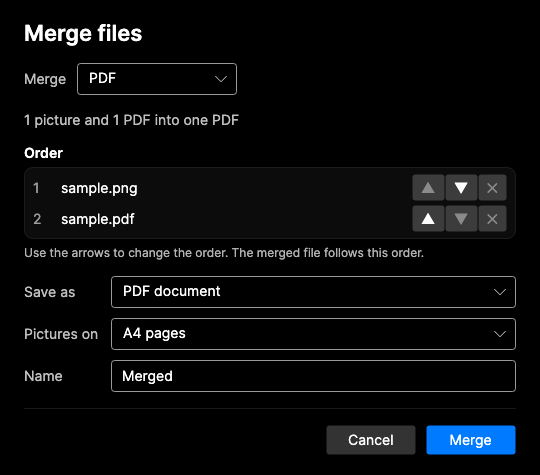

# Universal Converter

Universal Converter converts files between formats on your own computer. Drop a file in, pick a format, and it does the rest. It reads what is *inside* a file to work out its type, so a file with the wrong name still converts.

It comes as two native apps from one codebase:

| | macOS | Windows |
|---|---|---|
| Needs | A Mac with Apple silicon, macOS 14 or later | Windows 10 or 11, 64-bit |
| Built with | Swift and SwiftUI | C# (.NET 10) and Avalonia |
| Install | Build it with `scripts/make-app.sh` (see below) | Download `UniversalConverter.exe`, one file, nothing else to install |
| Code | This folder, the Swift packages and `Sources/` | [`windows/`](windows/README.md) |
| Guide | [GUIDE.md](GUIDE.md) | [windows/README.md](windows/README.md) |

Everything runs on your computer. Nothing is uploaded, and the apps collect no data (see [PRIVACY.md](PRIVACY.md)). Code translation uses a model that runs locally through [Ollama](https://ollama.com).

<p align="center">
  
  
</p>

## Features

Both apps share the same ideas and most of the same features:

- **Detection by content.** The file's contents decide its format, not its name.
- **Routes of up to three steps.** Markdown to PDF, for example, goes through Word. The app finds the chain and shows it in the format menu.
- **Installs on demand.** Pictures, Word and text documents, audio, and archives work straight away. Other formats need an optional tool, which you install from **Tools** with one click. Several tools can install at once, and each one can be removed again with its **Remove** button (after a confirmation).
- **Merging.** When the list holds two or more files of the same kind, they can be joined into one: pictures and PDFs into a PDF, audio into one audio file, videos into one video, and text documents into one document. You choose the order, the format and the name.
- **Pictures.** Compress to a size you type, resize, crop with a box you drag, remove the background, draw a sketch, and keep or remove camera and location details.
- **Text from pictures and scans.** Text is read with the system's own text recognition: Vision on the Mac, Windows.Media.Ocr on Windows.
- **Code translation.** Translates code between languages with a local model, then checks the result with the language's own compiler or parser.
- **Work runs side by side.** Conversions run two to four at a time, depending on the processor cores, and each one gets its share of the cores.

## macOS app

### What it converts

| Kind | Formats |
|---|---|
| Video | MP4, MKV, WebM, AVI, MOV, WMV, FLV, 3GP, M2TS, MPG, VOB, GIF |
| Audio | MP3, WAV, FLAC, M4A, OGG |
| Images | PNG, JPEG, WebP, GIF, BMP, TIFF, AVIF, HEIC, camera RAW (CR2, CR3, NEF, ARW, DNG, RAF, ORF, RW2), SVG, PDF. Pictures can be compressed to a size you choose, resized, cropped with a draggable box, drawn as a sketch, or have their background removed. Text can be read from pictures and scanned PDFs. |
| Documents | DOCX, DOC, ODT, RTF, PDF, HTML, TXT, Markdown, EPUB, Jupyter notebooks. PDFs can be compressed to a size you choose. |
| Spreadsheets, slides | XLSX, XLS, ODS, CSV, PPTX, PPT, ODP |
| E-books | EPUB, MOBI, AZW3, FB2 |
| PostScript | PS, EPS |
| 3D models | OBJ, STL, PLY, COLLADA, glTF, GLB |
| Fonts | TTF, OTF, WOFF, WOFF2 |
| Subtitles | SRT, VTT, ASS |
| Archives | ZIP, 7z, tar.gz, tar, and RAR as input |
| Code | Python, Java, C, C++, Rust, JavaScript, TypeScript, Ruby, Go, C# |

Merging joins pictures and PDFs into one PDF, audio files into one audio file, videos into one video, and text documents into one document. See [GUIDE.md](GUIDE.md), section 4e.

Some conversions need several steps, such as Markdown to PDF. See [GUIDE.md](GUIDE.md) for the full list.

### How it works

The app identifies the file, plans a route, and runs the right tools. Pictures use the frameworks built into macOS, and most other formats use a separate tool:

```
file  →  detect by content  →  plan a route  →  run each step  →  result
                                  (up to 3 steps)
```

| Tool | Used for |
|---|---|
| FFmpeg | Video, audio, subtitles, merging audio and video |
| macOS (ImageIO, Core Image, Vision) | Pictures, HEIC, camera RAW, background removal, sketches, text recognition |
| ImageMagick | WebP, AVIF, SVG, and pictures to PDF |
| LibreOffice | Documents, spreadsheets, slides |
| Pandoc | Markdown, HTML, EPUB, notebooks, merging documents |
| Calibre | E-books |
| Poppler, Ghostscript | PDF and PostScript |
| Assimp | 3D models |
| 7-Zip, tar | Archives |
| fontTools | Fonts |
| Ollama | Code translation, checked afterwards with each language's own compiler or parser |

### Requirements

- A Mac with Apple silicon, running macOS 14 or later. Built and tested on macOS 27.
- [Homebrew](https://brew.sh), to install the optional tools.
- Xcode, to build the app.
- About 6 GB of disk space, mostly for LibreOffice and the code model. 16 GB of memory is comfortable.

### Get started

1. **Build and open the app** (see below).
2. **Open the app.** Pictures, Word and text documents, audio (WAV, M4A) and archives (ZIP, TAR) work straight away. They use tools that come with macOS, so there is nothing to install.
3. **For more formats, open Settings → Tools** and click **Install** next to what you need, or **Install everything**. The app runs Homebrew for you and shows progress in the status bar.

Installs use [Homebrew](https://brew.sh). If you do not have it, install it once from that page, then come back to the app.

### Build and run

```bash
git clone https://github.com/Farook-Sayed/UniversalConverter-Apps.git
cd UniversalConverter-Apps
./scripts/make-app.sh
open "build/Universal Converter.app"
```

`make-app.sh` generates the Xcode project from `project.yml` and builds it. The generated `Universal Converter.xcodeproj` is also checked in, so you can open it in Xcode directly.

The app is signed ad hoc, so it runs on the Mac that built it. To share a build, sign it with your own Developer ID and notarize it with `scripts/sign-and-notarize.sh`; see [DISTRIBUTION.md](DISTRIBUTION.md). The bundle identifier is `dev.cosmion.converter`. Change it in `project.yml` and `Resources/Info.plist` if you publish your own build.

### Tests

```bash
swift test
```

Tests that need a tool skip themselves when it is not installed. To test every conversion on real files:

```bash
./scripts/make-test-files.sh
FC_RUN_MATRIX=1 swift test --filter ConversionMatrixTests
```

The matrix converts each sample file to every format offered for it and checks each result. It takes several minutes and writes `build/matrix-report.txt`.

### Known limits

- Code over 256 KB is refused. Longer files are split at their top-level definitions, translated part by part and joined, so they take longer. Java output is one class named after the file, and it is checked with javac. A long Java class translated to another language becomes top-level functions and variables, so check how they fit together.
- Translated code is checked for syntax. It is not tested for behaviour.
- Archives are fully extracted to a temporary folder first. A very large archive needs that much free space.
- RAR files can be read, but not written.
- Camera RAW depends on macOS supporting the camera. It is tested with a generated DNG file, not with files from each brand.
- Text recognition works best on printed text. Handwriting and unusual fonts are read less well, and a table is read column by column.
- Password-protected PDFs: a PDF that only has restrictions (no printing or copying) opens at once. One with a password asks for it, and a password that fits several files is typed once. The password must be known: the app never guesses one. Opened PDFs are converted from a copy without protection, and **Save Copy Without Password** keeps that copy. The copy is rebuilt page by page, so the text, pictures and drawings stay, but bookmarks and form fields do not.
- A progress percentage is shown for videos, audio, scanned PDFs, translated code, custom PDF sizes, merges and conversions in several steps. Other conversions show a spinner.
- The app is not yet signed with a Developer ID or notarized, so macOS and some security software may warn about it.
- Only tested on Apple silicon.

## Windows app

The Windows app is in [`windows/`](windows/README.md). It does the same job as the Mac app, and its guide covers everything in detail. In short:

- **Get it:** download `UniversalConverter.exe` and run it. It is one file, about 85 MB, and needs nothing else installed. Windows 10 (1903 or later) and Windows 11, 64-bit.
- **Works with nothing to install:** pictures, PDF pages, scanned text (with Windows' own recognition), archives (ZIP, 7z, RAR, tar, tar.gz), 3D models, picture adjustments and merging pictures and PDFs.
- **Optional tools:** video, Office, Markdown, e-books, PDF compression, 7-Zip, fonts, code translation and code checks install from **Settings and tools → Tools** through winget, with a **Remove…** button for each one.
- **Build it:** `cd windows && ./scripts/build-exe.sh` makes `dist/UniversalConverter.exe`. The .NET 10 SDK is needed; it builds on Windows, macOS and Linux.
- **Status:** built and tested on a Mac and checked by GitHub's Windows runner (tests, the `.exe` build, and a start-up check). **Not yet run on a real Windows PC** by its authors. The known limits are listed in [windows/README.md](windows/README.md).

## Repository layout

```
Sources/ConverterCore/   macOS: detection, routing, tool calls, merging, warnings. No user interface.
Sources/FileConverter/   macOS: the SwiftUI app.
Tests/ConverterCoreTests macOS: unit tests, integration tests, and the conversion matrix.
scripts/                 macOS build, sample files, and design snapshots.
windows/                 Windows: the C# app, its tests and its build script (see windows/README.md).
.github/workflows/       Continuous integration for both: ci.yml (macOS), windows.yml (Windows).
Icon/                    The macOS app icon, in Icon Composer format.
docs/                    Images for this page.
```

More: [GUIDE.md](GUIDE.md) (using the Mac app), [DESIGN.md](DESIGN.md) (design rules), [DESIGN_LOG.md](DESIGN_LOG.md) (decisions), [CONTRIBUTING.md](CONTRIBUTING.md), [PRIVACY.md](PRIVACY.md), [DISTRIBUTION.md](DISTRIBUTION.md) (signing, publishing and the law).

## Continuous integration

- **macOS** (`ci.yml`): runs `swift test` on a Mac runner and builds the app. The conversion tools are not installed on the runner, so tests that need them skip.
- **Windows** (`windows.yml`): runs the Windows tests, builds `UniversalConverter.exe`, and starts it once to check that it opens a window.

## License

[MIT](LICENSE). The tools the apps run are separate programs with their own licenses, and the Windows app contains libraries with theirs. See [THIRD_PARTY_NOTICES.md](THIRD_PARTY_NOTICES.md). The names of the programs and systems the apps work with belong to their owners; Universal Converter is not affiliated with them.
